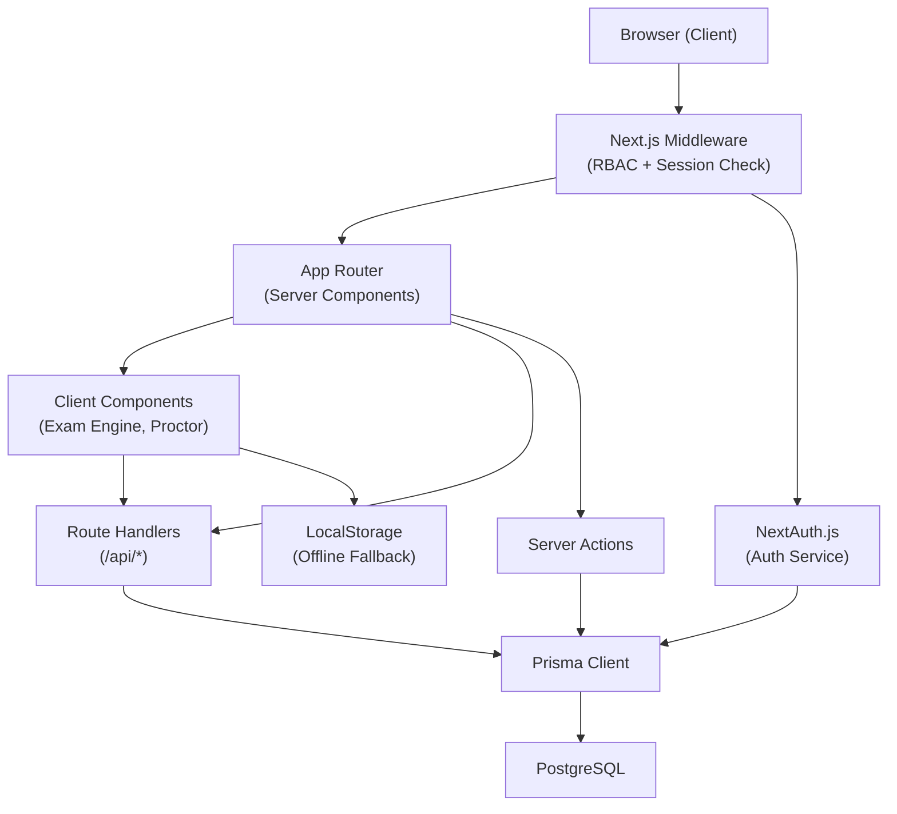
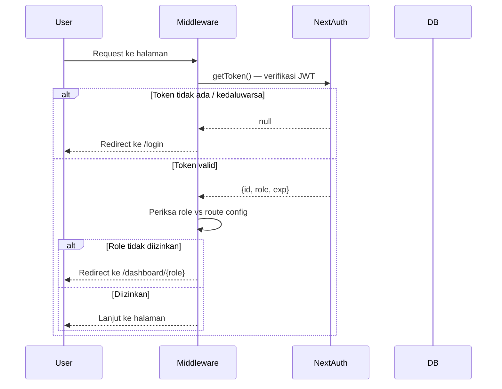
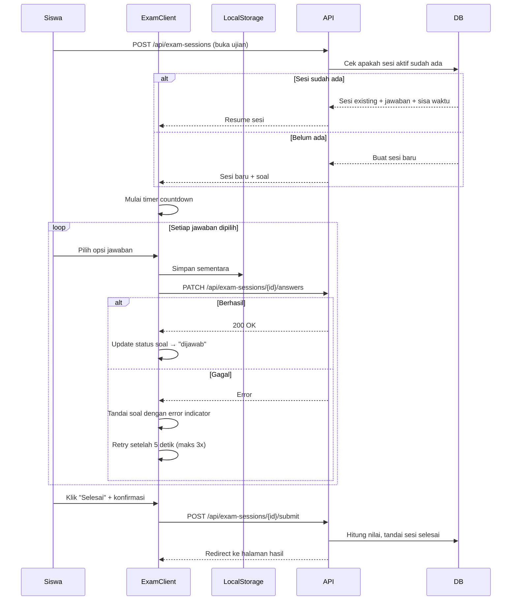

# Design Document — Ujian App

## Overview

Ujian App adalah aplikasi ujian online berbasis web yang dibangun dengan Next.js 14 (App Router). Aplikasi ini melayani tiga peran pengguna: **Admin**, **Guru**, dan **Siswa**, masing-masing dengan alur kerja dan hak akses tersendiri.

Tujuan utama desain ini adalah:

- Menyediakan platform ujian yang aman dengan pengawasan (proctoring) berbasis browser
- Memastikan integritas data jawaban siswa bahkan saat koneksi terputus
- Menghasilkan laporan yang akurat dan dapat diekspor dalam format PDF dan Excel
- Mempertahankan konsistensi data historis saat soal diperbarui setelah ujian selesai

**Batasan utama:**
- Soal hanya berformat pilihan ganda (empat opsi, satu kunci jawaban)
- Proctoring dilakukan sepenuhnya di sisi klien (fullscreen API + Page Visibility API)
- Ekspor laporan dilakukan di sisi klien menggunakan jsPDF dan SheetJS

---

## Architecture

### Pendekatan Arsitektur

Aplikasi menggunakan arsitektur **full-stack monolith** berbasis Next.js 14 App Router dengan pola sebagai berikut:

- **Server Components** untuk rendering halaman yang tidak membutuhkan interaktivitas (dashboard, laporan)
- **Client Components** untuk interaksi real-time (exam engine, proctoring, timer)
- **Route Handlers** (`/api/*`) sebagai API endpoints untuk operasi data
- **Server Actions** untuk mutasi data sederhana yang tidak membutuhkan validasi kompleks
- **Middleware** Next.js untuk penegakan RBAC di level edge sebelum request mencapai halaman

### Diagram Arsitektur



### Alur Autentikasi dan Otorisasi



### Alur Exam Engine



---

## Components and Interfaces

### Struktur Direktori

```
src/
├── app/
│   ├── (auth)/
│   │   └── login/
│   ├── (admin)/
│   │   └── dashboard/
│   │       └── users/
│   ├── (guru)/
│   │   └── dashboard/
│   │       ├── bank-soal/
│   │       ├── ujian/
│   │       └── laporan/
│   ├── (siswa)/
│   │   └── dashboard/
│   │       └── ujian/
│   │           └── [examId]/
│   │               └── kerjakan/
│   └── api/
│       ├── auth/[...nextauth]/
│       ├── users/
│       ├── questions/
│       ├── exams/
│       ├── exam-sessions/
│       └── reports/
├── components/
│   ├── auth/
│   ├── exam/
│   │   ├── ExamEngine.tsx          — Client Component utama
│   │   ├── QuestionDisplay.tsx
│   │   ├── NavigationPanel.tsx
│   │   ├── CountdownTimer.tsx
│   │   └── SubmitConfirmDialog.tsx
│   ├── proctor/
│   │   ├── ProctorService.tsx      — Client Component untuk proctoring
│   │   ├── FullscreenGuard.tsx
│   │   └── ViolationWarningModal.tsx
│   ├── reports/
│   │   ├── GradeTable.tsx
│   │   ├── QuestionAnalysisTable.tsx
│   │   ├── GradeDistributionChart.tsx  — Recharts wrapper
│   │   └── ExportButtons.tsx
│   └── ui/                         — Komponen UI generik
├── lib/
│   ├── auth.ts                     — NextAuth config
│   ├── prisma.ts                   — Prisma client singleton
│   ├── scoring.ts                  — Logika perhitungan nilai
│   ├── export/
│   │   ├── pdf.ts                  — jsPDF generator
│   │   └── excel.ts                — SheetJS generator
│   └── validators/                 — Zod schema validasi input
├── hooks/
│   ├── useExamTimer.ts
│   ├── useProctor.ts
│   └── useOfflineSync.ts
├── middleware.ts                   — RBAC middleware
└── types/
    └── index.ts                    — Shared TypeScript types
```

### API Endpoints

| Method | Endpoint | Deskripsi | Role |
|--------|----------|-----------|------|
| `POST` | `/api/auth/[...nextauth]` | NextAuth handler | Public |
| `GET` | `/api/users` | Daftar pengguna | Admin |
| `POST` | `/api/users` | Buat pengguna baru | Admin |
| `PATCH` | `/api/users/[id]` | Ubah pengguna | Admin |
| `PATCH` | `/api/users/[id]/status` | Aktif/nonaktif | Admin |
| `GET` | `/api/questions` | Daftar soal milik guru | Guru |
| `POST` | `/api/questions` | Buat soal baru | Guru |
| `PATCH` | `/api/questions/[id]` | Ubah soal | Guru |
| `DELETE` | `/api/questions/[id]` | Hapus soal | Guru |
| `GET` | `/api/exams` | Daftar ujian | Guru |
| `POST` | `/api/exams` | Buat ujian | Guru |
| `PATCH` | `/api/exams/[id]` | Ubah konfigurasi ujian | Guru |
| `POST` | `/api/exams/[id]/publish` | Publikasikan ujian | Guru |
| `POST` | `/api/exams/[id]/assign` | Tugaskan ke siswa | Guru |
| `GET` | `/api/exams/assigned` | Ujian yang ditugaskan | Siswa |
| `POST` | `/api/exam-sessions` | Buka/resume sesi ujian | Siswa |
| `PATCH` | `/api/exam-sessions/[id]/answers` | Simpan jawaban | Siswa |
| `POST` | `/api/exam-sessions/[id]/submit` | Selesaikan ujian | Siswa |
| `POST` | `/api/exam-sessions/[id]/violations` | Catat pelanggaran | Siswa |
| `GET` | `/api/reports/[examId]` | Data laporan ujian | Guru |

### Komponen Kunci

#### `ExamEngine` (Client Component)
Komponen pusat yang mengorkestrasi seluruh pengerjaan ujian. Menerima data sesi awal via props dari Server Component induk, lalu mengelola state secara lokal.

```typescript
interface ExamEngineProps {
  session: ExamSession & { exam: Exam & { questions: Question[] } };
  savedAnswers: Answer[];
  remainingSeconds: number;
}
```

#### `ProctorService` (Client Component)
Mengelola proctoring dengan dua mode independen. Menggunakan:
- `document.fullscreenElement` + `fullscreenchange` event untuk deteksi fullscreen
- `document.visibilityState` + `visibilitychange` event untuk deteksi tab switching
- `window.blur` / `window.focus` sebagai fallback tambahan untuk perpindahan aplikasi

```typescript
interface ProctorConfig {
  fullscreenEnabled: boolean;
  tabSwitchEnabled: boolean;
  maxViolations: number;
  sessionId: string;
  onViolation: (type: 'fullscreen_exit' | 'tab_switch') => void;
  onAutoSubmit: () => void;
}
```

#### `useOfflineSync` (Custom Hook)
Mengelola sinkronisasi jawaban saat offline menggunakan IndexedDB sebagai storage lokal yang lebih andal dibanding localStorage untuk data terstruktur.

```typescript
interface SyncState {
  pendingAnswers: PendingAnswer[];
  isSyncing: boolean;
  lastSyncAt: Date | null;
  syncErrors: Record<number, number>; // questionIndex → retry count
}
```

#### `scoring.ts` — Fungsi Perhitungan Nilai
```typescript
/**
 * Menghitung nilai akhir ujian.
 * @returns nilai dalam rentang 0.00–100.00, dibulatkan 2 desimal
 */
function calculateScore(
  answers: Answer[],
  questions: Question[]
): number

/**
 * Menghitung persentase jawaban benar per soal.
 * @returns persentase 0.00–100.00, dibulatkan 2 desimal
 */
function calculateQuestionCorrectRate(
  questionId: string,
  allAnswers: Answer[]
): number
```

---

## Data Models

### Prisma Schema

```prisma
// prisma/schema.prisma

generator client {
  provider = "prisma-client-js"
}

datasource db {
  provider = "postgresql"
  url      = env("DATABASE_URL")
}

enum Role {
  ADMIN
  GURU
  SISWA
}

enum ExamStatus {
  DRAFT
  PUBLISHED
}

enum SessionStatus {
  ACTIVE
  SUBMITTED
  EXPIRED
}

enum ViolationType {
  FULLSCREEN_EXIT
  TAB_SWITCH
}

// ─── User ────────────────────────────────────────────────────────────────────

model User {
  id          String    @id @default(cuid())
  name        String    @db.VarChar(100)
  email       String    @unique @db.VarChar(255)
  password    String                        // bcrypt hash
  role        Role
  isActive    Boolean   @default(true)
  failedLoginAttempts Int @default(0)
  lockedUntil DateTime?
  createdAt   DateTime  @default(now())
  updatedAt   DateTime  @updatedAt

  // Relations
  questions   Question[]
  exams       Exam[]
  assignments ExamAssignment[]
  sessions    ExamSession[]
}

// ─── Question (Bank Soal) ─────────────────────────────────────────────────────

model Question {
  id          String    @id @default(cuid())
  guruId      String
  guru        User      @relation(fields: [guruId], references: [id])
  text        String    @db.VarChar(1000)
  optionA     String    @db.VarChar(500)
  optionB     String    @db.VarChar(500)
  optionC     String    @db.VarChar(500)
  optionD     String    @db.VarChar(500)
  correctOption String  @db.Char(1)         // "A" | "B" | "C" | "D"
  version     Int       @default(1)
  isDeleted   Boolean   @default(false)     // soft delete
  createdAt   DateTime  @default(now())
  updatedAt   DateTime  @updatedAt

  // Snapshot FK — snapshot soal yang diambil saat ujian dibuat
  examQuestions ExamQuestion[]
  // Jawaban siswa mengacu ke snapshot, bukan ke sini langsung
}

// ─── QuestionSnapshot ─────────────────────────────────────────────────────────
// Digunakan untuk mempertahankan versi soal historis (Req 3.6)

model QuestionSnapshot {
  id            String    @id @default(cuid())
  questionId    String                        // referensi ke Question asli
  version       Int
  text          String    @db.VarChar(1000)
  optionA       String    @db.VarChar(500)
  optionB       String    @db.VarChar(500)
  optionC       String    @db.VarChar(500)
  optionD       String    @db.VarChar(500)
  correctOption String    @db.Char(1)
  createdAt     DateTime  @default(now())

  examQuestions ExamQuestion[]
  answers       Answer[]
}

// ─── Exam ─────────────────────────────────────────────────────────────────────

model Exam {
  id               String     @id @default(cuid())
  guruId           String
  guru             User       @relation(fields: [guruId], references: [id])
  title            String     @db.VarChar(200)
  durationMinutes  Int                         // 1–300
  status           ExamStatus @default(DRAFT)
  fullscreenEnabled  Boolean  @default(false)
  tabSwitchDetection Boolean  @default(false)
  maxViolations    Int?                        // null = tidak ada batas
  createdAt        DateTime   @default(now())
  updatedAt        DateTime   @updatedAt

  examQuestions    ExamQuestion[]
  assignments      ExamAssignment[]
  sessions         ExamSession[]
}

// ─── ExamQuestion ─────────────────────────────────────────────────────────────
// Menghubungkan Exam ke snapshot soal tertentu (versi saat ujian dibuat)

model ExamQuestion {
  id               String           @id @default(cuid())
  examId           String
  exam             Exam             @relation(fields: [examId], references: [id])
  snapshotId       String
  snapshot         QuestionSnapshot @relation(fields: [snapshotId], references: [id])
  originalQuestionId String
  orderIndex       Int              // urutan tampil soal

  answers          Answer[]

  @@unique([examId, orderIndex])
}

// ─── ExamAssignment ───────────────────────────────────────────────────────────

model ExamAssignment {
  id        String   @id @default(cuid())
  examId    String
  exam      Exam     @relation(fields: [examId], references: [id])
  siswaId   String
  siswa     User     @relation(fields: [siswaId], references: [id])
  createdAt DateTime @default(now())

  @@unique([examId, siswaId])
}

// ─── ExamSession ──────────────────────────────────────────────────────────────

model ExamSession {
  id              String        @id @default(cuid())
  examId          String
  exam            Exam          @relation(fields: [examId], references: [id])
  siswaId         String
  siswa           User          @relation(fields: [siswaId], references: [id])
  status          SessionStatus @default(ACTIVE)
  startedAt       DateTime      @default(now())
  submittedAt     DateTime?
  remainingSeconds Int          // diperbarui periodik dari klien
  finalScore      Decimal?      @db.Decimal(5, 2)   // 0.00–100.00

  answers         Answer[]
  violations      Violation[]

  @@unique([examId, siswaId])   // satu sesi aktif per siswa per ujian (Req 8.3)
}

// ─── Answer ───────────────────────────────────────────────────────────────────

model Answer {
  id             String        @id @default(cuid())
  sessionId      String
  session        ExamSession   @relation(fields: [sessionId], references: [id])
  examQuestionId String
  examQuestion   ExamQuestion  @relation(fields: [examQuestionId], references: [id])
  snapshotId     String
  snapshot       QuestionSnapshot @relation(fields: [snapshotId], references: [id])
  selectedOption String        @db.Char(1)   // "A" | "B" | "C" | "D"
  isCorrect      Boolean
  answeredAt     DateTime      @default(now())

  @@unique([sessionId, examQuestionId])
}

// ─── Violation ────────────────────────────────────────────────────────────────

model Violation {
  id          String        @id @default(cuid())
  sessionId   String
  session     ExamSession   @relation(fields: [sessionId], references: [id])
  type        ViolationType
  occurredAt  DateTime      @default(now())
}
```

### Keputusan Desain Data

**Pola Snapshot Soal (QuestionSnapshot)**

Requirement 3.6 mengharuskan perubahan soal setelah ujian selesai tidak merusak data historis. Solusi yang dipilih adalah pola _snapshot-on-use_: ketika guru menambahkan soal ke ujian, sistem membuat `QuestionSnapshot` yang menyimpan isi soal pada saat itu. `Answer` dan `ExamQuestion` mengacu ke snapshot, bukan ke `Question` langsung. Ini memastikan:
- Jawaban siswa selalu dapat dievaluasi terhadap soal versi yang benar
- Guru bebas mengubah `Question` asli tanpa memengaruhi ujian yang sudah selesai

**Soft Delete pada Question**

`Question` tidak dihapus secara fisik dari database jika pernah digunakan di ujian (Req 3.8). Kolom `isDeleted` digunakan sebagai soft delete. Query bank soal selalu memfilter `isDeleted: false`.

**Constraint Unique pada ExamSession**

`@@unique([examId, siswaId])` pada `ExamSession` menegakkan Req 8.3 (satu sesi aktif per siswa per ujian) di level database, bukan hanya di level aplikasi.

**`remainingSeconds` pada ExamSession**

Sisa waktu disimpan di server dan diperbarui secara periodik (setiap 30 detik) dari klien. Ini memungkinkan pemulihan sesi yang akurat setelah halaman di-reload (Req 8.2), dengan toleransi ketidakakuratan clock sebesar ≤3 detik seperti yang disyaratkan.

---

## Correctness Properties

*A property is a characteristic or behavior that should hold true across all valid executions of a system — essentially, a formal statement about what the system should do. Properties serve as the bridge between human-readable specifications and machine-verifiable correctness guarantees.*

### Property 1: Perhitungan nilai adalah deterministik dan berada dalam rentang valid

*For any* kombinasi jumlah jawaban benar K (0 ≤ K ≤ N) dan total soal N (N ≥ 1), fungsi `calculateScore` SHALL menghasilkan nilai yang identik setiap kali dipanggil dengan input yang sama, berada dalam rentang \[0.00, 100.00\], dan dibulatkan ke tepat dua desimal.

**Validates: Requirements 7.1, 7.9**

### Property 2: Persentase jawaban benar per soal berada dalam rentang valid

*For any* soal dalam ujian dengan setidaknya satu siswa menjawab, `calculateQuestionCorrectRate` SHALL menghasilkan nilai dalam rentang \[0.00, 100.00\] yang dibulatkan ke dua desimal — terlepas dari jumlah siswa dan distribusi pilihan jawaban.

**Validates: Requirements 7.4**

### Property 3: Nilai rata-rata kelas adalah rata-rata aritmetika yang benar

*For any* kumpulan nilai akhir dari satu atau lebih sesi yang selesai, nilai rata-rata kelas SHALL sama persis dengan jumlah semua nilai akhir dibagi jumlah sesi, dibulatkan ke dua desimal.

**Validates: Requirements 7.3**

### Property 4: Laporan diurutkan dari nilai tertinggi ke terendah

*For any* kumpulan sesi ujian yang telah selesai, daftar siswa dalam laporan SHALL selalu terurut berdasarkan `finalScore` secara descending — tidak ada pasangan berurutan i, i+1 di mana `score[i] < score[i+1]`.

**Validates: Requirements 7.2**

### Property 5: Distribusi nilai memasukkan setiap nilai ke bucket yang tepat

*For any* nilai akhir S dalam \[0.00, 100.00\], nilai tersebut SHALL muncul tepat pada bucket interval `⌊S/10⌋ × 10` dalam distribusi grafik, kecuali nilai 100.00 yang masuk ke bucket 91–100.

**Validates: Requirements 7.5**

### Property 6: Snapshot soal tidak berubah setelah dibuat

*For any* `QuestionSnapshot` yang telah disimpan ke database, seluruh field kontennya (text, optionA–D, correctOption) SHALL identik saat dibaca kembali kapanpun, terlepas dari operasi update apapun yang dilakukan pada `Question` asalnya setelahnya.

**Validates: Requirements 3.6**

### Property 7: Input whitespace-only pada field soal selalu ditolak

*For any* string yang terdiri seluruhnya dari karakter whitespace (`' '`, `'\t'`, `'\n'`, `'\r'`) atau string kosong, validator soal SHALL menolaknya untuk setiap field teks (pertanyaan dan opsi jawaban) tanpa menyimpan data apapun ke database.

**Validates: Requirements 3.2, 3.3**

### Property 8: Soal yang terkait ujian tidak dapat dihapus

*For any* `Question` yang memiliki setidaknya satu referensi ke `ExamQuestion` (baik dari ujian aktif maupun selesai), permintaan DELETE SHALL ditolak dengan status 422 — terlepas dari siapa yang melakukan permintaan.

**Validates: Requirements 3.8**

### Property 9: Transisi status ujian hanya valid dari state tertentu

*For any* `Exam`, permintaan publish SHALL hanya berhasil jika status saat ini adalah `DRAFT`, dan permintaan assign siswa SHALL hanya berhasil jika status saat ini adalah `PUBLISHED` — semua percobaan dari state lain SHALL ditolak.

**Validates: Requirements 4.7, 4.8, 4.9, 4.10**

### Property 10: RBAC — setiap role hanya mengakses route yang diizinkan

*For any* kombinasi (role, route), keputusan akses middleware SHALL konsisten dengan konfigurasi RBAC yang ditetapkan — role yang tidak diizinkan SHALL selalu diarahkan ke halaman beranda perannya, bukan ke halaman yang diminta.

**Validates: Requirements 1.7, 1.8, 2.1**

### Property 11: Akumulasi pelanggaran monoton dan setiap event menghasilkan tepat satu violation

*For any* `ExamSession` yang aktif dengan proctoring diaktifkan, setiap satu event pelanggaran (fullscreen exit atau tab switch) SHALL menghasilkan tepat satu entri `Violation`, dan jumlah total violation SHALL tidak pernah berkurang seiring berjalannya waktu.

**Validates: Requirements 6.2, 6.3, 6.7**

### Property 12: Auto-submit saat batas pelanggaran tercapai mempertahankan jawaban

*For any* `ExamSession` dengan `maxViolations` = N, ketika violation ke-N dicatat, sistem SHALL mengubah status sesi menjadi `SUBMITTED` dan jumlah jawaban yang tersimpan SHALL tidak berkurang dari jumlah jawaban sebelum pengakhiran otomatis.

**Validates: Requirements 6.5**

### Property 13: Satu sesi aktif per siswa per ujian

*For any* pasangan (siswa, ujian), percobaan membuat `ExamSession` baru ketika sesi `ACTIVE` sudah ada SHALL ditolak dengan status 409 — constraint ini berlaku bahkan untuk request yang datang secara bersamaan.

**Validates: Requirements 8.3**

### Property 14: Jawaban tersimpan dapat diambil kembali secara akurat

*For any* `Answer` yang berhasil disimpan ke server (mendapat respons 2xx), jawaban tersebut SHALL dapat diambil kembali dengan `selectedOption` dan `examQuestionId` yang identik pada request GET sesi berikutnya.

**Validates: Requirements 5.5, 8.2**

---

## Error Handling

### Strategi Umum

Semua Route Handlers menggunakan pola response yang konsisten:

```typescript
// Sukses
{ data: T, message?: string }

// Gagal
{ error: string, details?: Record<string, string> }  // details untuk validasi field
```

HTTP status codes yang digunakan:
- `200` — OK
- `201` — Created
- `400` — Bad Request (validasi gagal)
- `401` — Unauthorized (tidak terautentikasi)
- `403` — Forbidden (role tidak diizinkan)
- `404` — Not Found
- `409` — Conflict (duplikat email, sesi sudah ada)
- `422` — Unprocessable Entity (aturan bisnis dilanggar)
- `500` — Internal Server Error

### Error Handling per Komponen

#### Auth Service (Req 1.2, 1.3)
- Login gagal: kembalikan pesan generik "Email atau password salah" tanpa mengungkap field spesifik
- Setelah 5 kali gagal berurutan: set `lockedUntil = now() + 15 menit`, reset `failedLoginAttempts = 0`
- Setiap login berhasil: reset `failedLoginAttempts = 0`
- Middleware membaca `lockedUntil` sebelum memproses autentikasi

#### Exam Engine — Offline & Retry (Req 5.6, 8.1, 8.4)
- Jawaban pertama kali disimpan ke **IndexedDB** sebelum dikirim ke server
- Jika request gagal: retry dengan interval 5 detik, maksimal 3 kali
- Setelah 3 kali gagal: tampilkan error indicator di panel navigasi, jawaban tetap ada di IndexedDB
- Saat koneksi pulih (`window.online` event): sinkronisasi semua jawaban pending ke server
- Sinkronisasi dilakukan secara serial (bukan paralel) untuk menghindari race condition

#### Proctor Service — Auto-submit gagal (Req 6.6)
- Jika `POST /api/exam-sessions/{id}/submit` gagal saat auto-submit akibat violation:
  - Tampilkan pesan kesalahan kepada siswa
  - Pertahankan status sesi sebagai `ACTIVE`
  - Tombol "Coba Submit Ulang" disediakan
  - Jangan mencatat violation baru selama dalam state error ini

#### Report Export — Timeout (Req 7.6, 7.7)
- Ekspor dijalankan di sisi klien menggunakan jsPDF / SheetJS
- Implementasi fungsi export dibungkus dengan `Promise.race` dan timeout 30 detik
- Jika timeout: tampilkan toast error "Gagal menghasilkan laporan dalam batas waktu yang ditentukan"

#### Account Lockout — Session Invalidation (Req 2.8)
- Saat admin menonaktifkan akun, server menyimpan timestamp penonaktifan di `User.updatedAt` dan mengubah `isActive = false`
- Middleware NextAuth memverifikasi `isActive` pada setiap request dengan memanggil DB lookup ringan
- Sesi yang sudah ada akan gagal pada pemeriksaan middleware berikutnya (dalam request berikutnya dalam ~60 detik)
- **Catatan**: Pengakhiran sesi real-time dalam tepat 60 detik bergantung pada aktivitas request dari klien tersebut; implementasi menggunakan pemeriksaan per-request sebagai pendekatan yang aman dan sederhana.

---

## Testing Strategy

### Pendekatan Dual Testing

Strategi pengujian menggabinasikan **unit/integration tests** untuk kasus-kasus spesifik dan **property-based tests** untuk memverifikasi invariant universal pada logika bisnis murni.

### Unit & Integration Tests

**Target:**
- Fungsi `calculateScore` dan `calculateQuestionCorrectRate` dengan contoh konkret (nilai 0, 50, 100, pembulatan tepi)
- Validator Zod: memastikan tiap field yang tidak valid memunculkan error yang tepat
- Route Handlers: menggunakan Prisma mock (`jest-mock-extended`) untuk memastikan logika kondisional (duplikat email, status ujian, kepemilikan soal)
- Komponen React: menggunakan Vitest + Testing Library untuk `ExamEngine`, `NavigationPanel`, dan `CountdownTimer`
- `ProctorService`: simulasi `visibilitychange` dan `fullscreenchange` events di jsdom

**Framework:** Vitest + @testing-library/react + jest-mock-extended

### Property-Based Tests

**Framework:** [fast-check](https://github.com/dubzzz/fast-check) — library PBT untuk TypeScript/JavaScript

**Konfigurasi:** Minimum **100 iterasi** per property test.

Setiap test ditandai dengan komentar:
```
// Feature: ujian-app, Property {N}: {deskripsi singkat property}
```

#### Property 1 — Determinisme dan Rentang Nilai
```
// Feature: ujian-app, Property 1: score deterministic and within valid range
```
Generator: integer N (1–200) sebagai total soal, integer K (0–N) sebagai jumlah benar. Verifikasi: `calculateScore(K, N) === calculateScore(K, N)` (deterministik), `0.00 ≤ result ≤ 100.00`, dan result memiliki tepat 2 desimal.

#### Property 2 — Rentang Persentase Soal
```
// Feature: ujian-app, Property 2: question correct rate within valid range
```
Generator: integer total (1–200) sebagai jumlah siswa menjawab, integer correct (0–total). Verifikasi: `0.00 ≤ calculateQuestionCorrectRate(correct, total) ≤ 100.00`.

#### Property 3 — Rata-rata Kelas adalah Mean Aritmetika
```
// Feature: ujian-app, Property 3: class average is correct arithmetic mean
```
Generator: array nilai akhir acak `Decimal(5,2)` (0.00–100.00, panjang 1–200). Verifikasi: `calculateClassAverage(scores) === round2(sum(scores) / scores.length)`.

#### Property 4 — Pengurutan Laporan Descending
```
// Feature: ujian-app, Property 4: report list sorted descending by score
```
Generator: array `ExamSession` acak dengan `finalScore` acak. Verifikasi: `report[i].finalScore >= report[i+1].finalScore` untuk semua i.

#### Property 5 — Distribusi Nilai ke Bucket yang Tepat
```
// Feature: ujian-app, Property 5: score distribution bucket assignment
```
Generator: nilai S acak dalam [0.00, 100.00]. Verifikasi: S muncul di bucket `Math.floor(S / 10) * 10` (atau bucket 91–100 untuk S = 100).

#### Property 6 — Immutabilitas Snapshot Soal
```
// Feature: ujian-app, Property 6: question snapshot immutability
```
Generator: objek `QuestionSnapshot` acak + serangkaian operasi update acak pada `Question` asalnya (menggunakan in-memory mock repository). Verifikasi: `readSnapshot(id)` sebelum dan sesudah update selalu identik.

#### Property 7 — Penolakan Input Whitespace-Only
```
// Feature: ujian-app, Property 7: whitespace-only input rejection
```
Generator: string yang terdiri dari karakter whitespace (`' '`, `'\t'`, `'\n'`, `'\r'`) dengan panjang acak 0–100. Verifikasi: validator Zod SELALU mengembalikan ZodError untuk semua string tersebut pada field `text`, `optionA–D`.

#### Property 8 — Soal Terkait Ujian Tidak Dapat Dihapus
```
// Feature: ujian-app, Property 8: linked question deletion rejected
```
Generator: `Question` acak yang terhubung ke minimal satu `ExamQuestion` (in-memory store). Verifikasi: `deleteQuestion(id)` SELALU melempar error / mengembalikan 422.

#### Property 9 — Transisi Status Ujian Valid
```
// Feature: ujian-app, Property 9: exam status transition guards
```
Generator: `Exam` dengan status acak ∈ {DRAFT, PUBLISHED}. Verifikasi: publish berhasil ↔ status = DRAFT; assign berhasil ↔ status = PUBLISHED.

#### Property 10 — RBAC Konsisten
```
// Feature: ujian-app, Property 10: RBAC access decision consistency
```
Generator: pasangan (role, routePath) acak dari enumasi lengkap semua kombinasi. Verifikasi: keputusan akses middleware SELALU konsisten dengan tabel konfigurasi RBAC yang ditetapkan.

#### Property 11 — Akumulasi Pelanggaran Monoton dan Tepat Satu per Event
```
// Feature: ujian-app, Property 11: violation count monotonically increases, one per event
```
Generator: urutan event acak (termasuk fullscreen exit dan tab switch) pada sesi in-memory. Verifikasi: (a) jumlah violation tidak pernah berkurang, (b) setiap event menghasilkan tepat satu entri Violation baru.

#### Property 12 — Auto-submit Mempertahankan Jawaban
```
// Feature: ujian-app, Property 12: auto-submit preserves all stored answers
```
Generator: `maxViolations` acak (1–100), urutan jawaban dan violation acak. Ketika violation ke-N dicatat: (a) status sesi = SUBMITTED, (b) `count(answers after) >= count(answers before)`.

#### Property 13 — Satu Sesi Aktif per Siswa per Ujian
```
// Feature: ujian-app, Property 13: single active session constraint
```
Generator: urutan request pembuatan sesi bersamaan untuk pasangan (siswaId, examId) yang sama (in-memory concurrent simulation). Verifikasi: tepat satu request berhasil, sisanya mendapat 409.

#### Property 14 — Jawaban Tersimpan Dapat Diambil Kembali
```
// Feature: ujian-app, Property 14: stored answers retrievable accurately
```
Generator: pasangan (examQuestionId, selectedOption) acak. Setelah `saveAnswer(...)` berhasil: `getSession(id).answers` SHALL mengandung entry dengan `selectedOption` dan `examQuestionId` yang identik.

### End-to-End Tests

**Framework:** Playwright

Skenario kritis yang diuji dengan E2E:
1. Alur lengkap: login Guru → buat soal → buat ujian → publish → assign ke Siswa → Siswa kerjakan → Guru lihat laporan → export PDF
2. Proctoring: fullscreen exit memunculkan modal dan mencatat violation
3. Resume sesi: reload halaman di tengah ujian memulihkan jawaban dan timer
4. Account lockout: 5 kali login gagal mengunci akun
